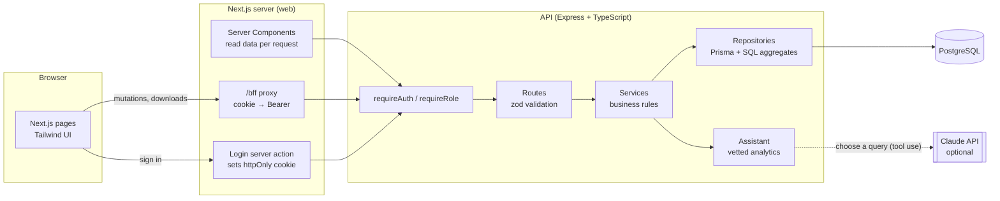

# Design notes

## Architecture



* **Two deployables.** `backend/` is the REST API and the single owner of business rules and permissions.
  `frontend/` is the Next.js app. The browser never talks to the API directly.
* **Backend layering.** Routes do HTTP and validation, services hold the business rules, and repositories
  handle persistence. Services depend on repository **interfaces**, so the unit tests use in-memory fakes
  and need no database.
* **Frontend.** Pages are Server Components that read filters from the URL, which makes links shareable
  and keeps the back button working. Forms are small Client Components that call the `/bff` proxy and then
  `router.refresh()`.

## Security model

| Concern | Decision |
|---|---|
| Authentication | Email + password; bcrypt (cost 10); a JWT is signed with `JWT_SECRET` (≥ 32 chars, and the API refuses to start in production without it), valid for 8 hours. Every failure returns the same "Invalid email or password", and a dummy bcrypt compare equalises timing so attackers can't tell which emails exist. |
| Token storage | The JWT lives in an **httpOnly, SameSite=Lax, Secure** cookie set by a server action. Browser JavaScript can't read it, so XSS can't steal it. The `/bff` proxy turns the cookie into a `Bearer` header. |
| CSRF | SameSite=Lax, plus the proxy rejects mutating requests whose `Origin` doesn't match the `Host` the browser used. *(Found in E2E: comparing with the server's own URL broke every save inside Docker.)* |
| Authorisation | Roles `HR_MANAGER` and `ADMIN`, enforced **in the API** on every route (`requireRole`). On each request the API re-reads the user from the DB, so disabling an account or changing a role takes effect on the user's very next request. Admins cannot disable or demote themselves. |
| Brute force | Login is rate-limited per **IP + email** (10 attempts / 15 min). Keying by IP alone would throttle everyone, because the web server proxies all logins from one address. |
| Audit | Every employee, pay and user mutation writes an `audit_logs` row **in the same transaction** as the change. Salary history also records `changedBy`. Password resets are logged as `passwordReset: true` and never with the value. |
| Input | zod validation at the API boundary; Prisma/parameterised SQL only. The single raw SQL fragment (the GROUP BY column) comes from an allow-list. |
| Exports | Text cells that start with `= + - @` are prefixed with `'`, which stops CSV/Excel formula injection. |
| Open redirects | The post-login `next` parameter only accepts same-site paths. |

## Data model

```mermaid
erDiagram
  Country  ||--o{ Employee : "works in"
  Employee ||--o{ SalaryChange : has
  User     ||--o{ SalaryChange : "changed by"
  User     ||--o{ AuditLog : "performed"
  Country { string code PK; string currency; decimal usdRate }
  Employee {
    int id PK
    string employeeCode UK
    string email UK
    string jobTitle
    string department
    string countryCode FK
    date hireDate
    enum status "ACTIVE | INACTIVE"
    int salary "base, local currency"
    int allowances
    int bonus
    int deductions
  }
  SalaryChange {
    int employeeId FK
    int previousSalary
    int newSalary
    int allowances
    int bonus
    int deductions
    date effectiveDate
    enum reason
    int changedById FK
  }
  User { int id PK; string email UK; string passwordHash; enum role; bool isActive }
  AuditLog { int userId FK; string action; string entityType; int entityId; json details; datetime createdAt }
```

* **Money is stored as integers** in whole local-currency units. **Gross = base + allowances + bonus**, and
  **net = gross − deductions**. Both are computed values and never stored, so they can't drift. The USD
  figures use the country's stored budget rate.
* **The current package is denormalised onto `Employee`**, so analytics don't need a "latest row" window
  function. Each change updates the employee and inserts a history row and an audit row in one
  transaction, with **optimistic concurrency** (`UPDATE … WHERE <package> = <package we validated>`).
* **Deactivate instead of delete.** The history is a record HR must keep, and analytics include only
  `ACTIVE` employees.
* **Currency belongs to the country.** Country is therefore not editable through PATCH, because a relocation
  is a pay event (see the requirements doc).

## API (all under `/api`; everything except login needs a Bearer token)

| Area | Endpoints | Role |
|---|---|---|
| Auth | `POST /auth/login`, `GET /auth/me` | public / any |
| Employees | `GET/POST /employees`, `GET/PATCH /employees/:id`, `POST /employees/:id/deactivate`, `/reactivate`, `POST /employees/:id/salary-changes`, `GET /employees/:id/audit` | HR, Admin |
| Insights | `GET /insights/summary`, `/breakdown?by=`, `/distribution`, `/top-earners`, `/benchmark` | HR, Admin |
| Assistant | `POST /assistant/ask` | HR, Admin |
| Reports | `GET /reports/:type?format=csv\|xlsx&…filters` with type = `employees`, `salary-history`, `departments`, `countries` | HR, Admin |
| Admin | `GET/POST /users`, `PATCH /users/:id`, `GET /audit-logs` | Admin |

## AI salary assistant

The requirement was natural-language answers **using validated database analytics**. The design keeps the
model away from the numbers:

1. A catalogue of **five vetted analytics queries** (summary, breakdown by country/department/title with a
   metric, top earners, pay band, distribution). These are the same SQL-backed services the dashboard uses.
2. Each query is exposed to Claude as a **strict tool** whose parameters are enums: real country codes,
   departments, job titles and metrics. The model can only *choose and parameterise* a query. It cannot
   write SQL or invent a filter.
3. The API re-validates every tool call with zod before running it. An invalid call goes back to the model
   as an `is_error` tool result and is never executed.
4. The response contains the model's short explanation **plus the raw result tables**, and the UI renders
   those as tables and charts. The system prompt requires every number to come from a tool result, and the
   user can check each one against the table shown.
5. **Model:** `claude-opus-5-5` (configurable via `ASSISTANT_MODEL`), effort `medium`, with server-side refusal
   fallbacks enabled. The loop is capped at 4 tool rounds.
6. **No API key, or an LLM error → the deterministic rule-based parser** maps common question shapes onto the
   same catalogue. The feature therefore always works and is fully unit-testable offline. The Claude path is
   tested with a scripted fake client.

## Trade-offs

| Decision | Alternative | Why this way |
|---|---|---|
| Separate Express API + Next.js BFF | Next.js API routes only | Clear boundary; the API is reusable (importer, BI). Cost: two deployables. |
| JWT in httpOnly cookie via BFF | Token in localStorage | Immune to token theft through XSS; no CORS exposure. Cost: a proxy hop. |
| Stateless JWT + DB re-check per request | Server sessions table | Revocation is immediate while auth stays simple. Cost: one indexed PK lookup per request. |
| LLM picks from vetted queries | Text-to-SQL | No injection risk and no hallucinated numbers, and the results are testable. Cost: questions outside the catalogue are declined. |
| SQL aggregation (`percentile_cont`) | Compute in Node | Scales without moving 10k rows into Node; covered by integration tests. |
| Offset pagination | Keyset | Users jump to arbitrary pages; offset over 10k rows is cheap. |
| Static FX table | Live FX feed | Reproducible reports, no external dependency. |
| Deactivate | Hard delete | Keeps the pay history and the audit trail. |

## Testing strategy

| Layer | Tool | What it proves | Count |
|---|---|---|---|
| Domain + services | Vitest, in-memory fakes | pay maths and rules, concurrency, audit-in-transaction contract, RBAC lock-out rules, password policy, exports (CSV escaping, formula injection, xlsx round-trip) | 155 total backend unit/HTTP tests |
| Assistant | Vitest + scripted LLM client | parser mapping, vetted-query validation, tool loop, invalid-call handling, LLM-failure fallback | (included above) |
| HTTP | Supertest on the real Express app | 401/403 matrix, validation, rate limiting, downloads, immediate lock-out | (included above) |
| SQL | Vitest against Postgres (isolated schema) | percentiles, gross payroll in USD, active-only filters, top earners, atomic audit, stale-write rejection | 12 |
| Frontend units | Vitest + Testing Library | forms, pay preview, filters, assistant chat, audit descriptions, origin check, safe redirects | 41 |
| End-to-end | Playwright in a real browser against the production containers | sign-in/out, redirects, httpOnly cookie, CSRF, each role's journeys, exports, assistant, admin, phone layouts | 29 |

## Performance

Measured on 10,000 employees and ~23.5k history rows (Docker Postgres on a laptop; authenticated requests, average of 5):

| Endpoint | Avg |
|---|---|
| `GET /employees?pageSize=100&sort=salary` | 32 ms |
| `GET /employees?search=sharma&country=IN` | 29 ms |
| `GET /insights/summary` | 24 ms |
| `GET /insights/breakdown?by=jobTitle` | 44 ms |
| `GET /insights/top-earners` | 20 ms |
| `POST /assistant/ask` (offline engine) | 39 ms |
| `GET /reports/employees?format=csv` (10k rows) | 0.75 s |
| `GET /reports/employees?format=xlsx` (10k rows) | 2.7 s |
| Seed 10k employees + history | ~7 s |

The auth re-check (one primary-key lookup) adds roughly 10 ms per request compared with the unauthenticated v1.
The Excel export is the slowest operation; it's a deliberate, infrequent download. If it becomes a problem,
exceljs's streaming `WorkbookWriter` and a background job are the next steps.

* Every list and insight is bounded by pagination or `GROUP BY`, and the filter columns (including `status`)
  are indexed. Everything interactive stays well inside the 300 ms target.
* At 1M rows, the next steps would be a `pg_trgm` index for search, keyset pagination, and streaming exports.
