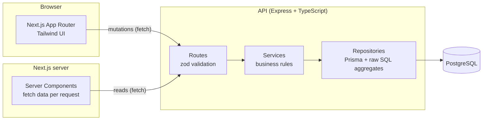
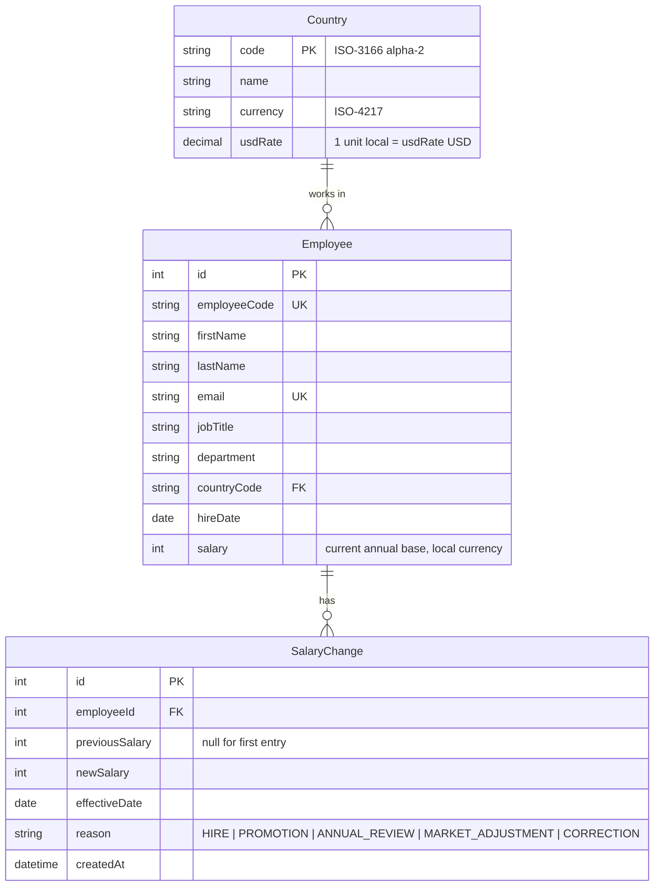

# Design notes

## Architecture

* **Two deployables** — `backend/` (REST API) and `frontend/` (Next.js). The API is the single owner of
  business rules; the UI never talks to the DB. This keeps the API reusable (e.g. a future Excel importer
  or BI tool) and lets each side be tested and scaled independently.
* **Backend layering**
  * `routes/` — HTTP only: parse + validate input with zod, call a service, map errors to status codes.
  * `services/` — business logic (salary change rules, USD conversion, shaping insight results). Depends
    on repository **interfaces**, so unit tests inject in-memory fakes: fast, deterministic, no DB.
  * `repositories/` — Prisma for CRUD; `$queryRaw` for aggregates where Postgres does the heavy lifting.
* **Frontend** — list/detail/insight pages are Server Components that read filters from the URL
  (`?country=DE&page=2`) — shareable links and working back button for free. Forms are small Client
  Components that call the API and `router.refresh()`.

## Data model

Key decisions
* **Current salary is denormalised onto `Employee`.** Every insight query aggregates *current* pay; reading
  it from the latest history row would need a window function per query. The service updates
  `Employee.salary` and inserts a `SalaryChange` **in one transaction**, so they cannot drift.
* **Currency belongs to the country**, not the employee row — prevents "German employee paid in INR" bugs
  and makes conversion a simple join.
* **Integers for money.** Annual base salaries are whole currency units; no floating point is persisted.
  USD figures are computed at query time and rounded for display only.
* **Indexes:** `(countryCode)`, `(department)`, `(jobTitle)`, `(countryCode, jobTitle)`, `(lastName, firstName)`
  and `(salaryChange.employeeId, effectiveDate)` — matching the filters and benchmarks the UI exposes.

## API

| Method | Path | Notes |
|---|---|---|
| GET | `/api/employees?search=&country=&department=&jobTitle=&sort=&order=&page=&pageSize=` | paginated, max pageSize 100 |
| GET | `/api/employees/:id` | includes salary history + country |
| POST | `/api/employees` | creates employee **and** an initial `HIRE` salary change |
| PATCH | `/api/employees/:id` | profile fields only — salary is changed via the endpoint below |
| DELETE | `/api/employees/:id` | cascades history |
| POST | `/api/employees/:id/salary-changes` | `{ newSalary, effectiveDate, reason }` |
| GET | `/api/meta` | countries, departments, job titles (for filter dropdowns) |
| GET | `/api/insights/summary?country=&department=` | headcount, payroll USD, avg/median USD |
| GET | `/api/insights/breakdown?by=country\|department\|jobTitle&country=&department=` | per-group stats |
| GET | `/api/insights/distribution?country=&department=` | USD histogram buckets |
| GET | `/api/insights/benchmark?country=&jobTitle=` | min/p25/median/p75/max in local currency |

Salary is intentionally **not** editable through `PATCH`: forcing changes through a dedicated endpoint
guarantees every change has a date and a reason.

## Trade-offs

| Decision | Alternative | Why this way |
|---|---|---|
| Separate Express API + Next.js | Next.js API routes only | Role asks for Express; a clean API boundary is easier to test and reuse. Cost: two deployables + CORS. |
| SQL aggregation (`percentile_cont`) | Load rows into Node and compute | 10k rows is small today, but aggregation in the DB scales and avoids shipping data over the wire. Cost: aggregate SQL is covered by integration tests rather than unit tests. |
| Offset pagination | Keyset/cursor pagination | Users jump to "page 37" and sort by many columns; offset on 10k rows is cheap. Keyset would matter at 1M+. |
| Static FX table | Live FX API | Reproducible reports, no external dependency. Rates editable in DB. |
| Strings for department / job title | Lookup tables | Fewer joins and simpler forms; values validated against an allow-list in the API. Would normalise when HR needs to rename titles in bulk. |
| No auth | Basic auth / SSO | Out of scope (see requirements); top of the production-hardening list. |

## Performance considerations
* All list and insight queries are bounded: pagination (max 100 rows) or `GROUP BY` results (≤ ~50 groups).
* Filter columns are indexed; search uses `ILIKE` on a handful of columns — fine at 10k rows
  (sequential scan on 10k rows is ~ms). At 1M rows we'd add a `pg_trgm` GIN index.
* Seed inserts with `createMany` in batches of 1,000 rows: 10k employees + ~25k history rows in seconds.
* Server Components fetch on the server, so the browser receives HTML, not JSON + a waterfall of requests.
